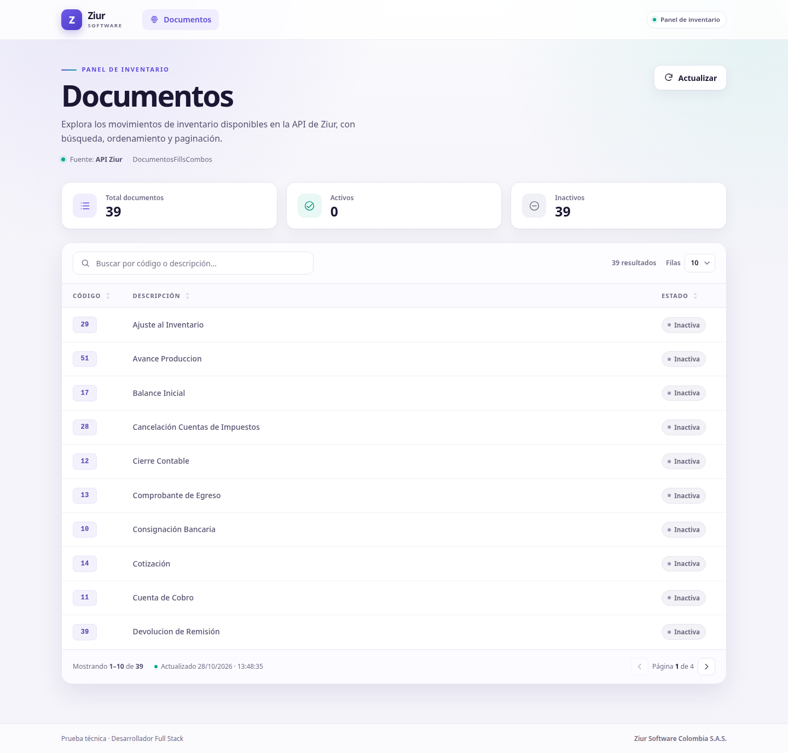
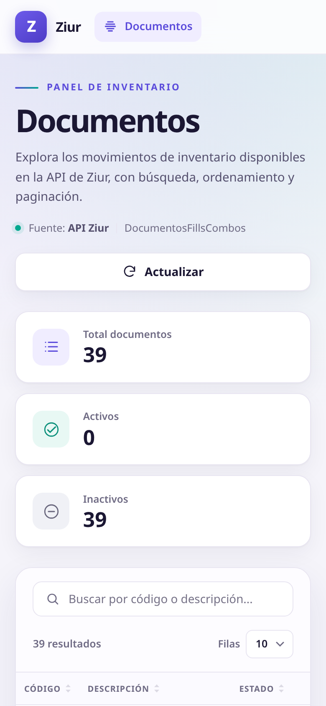

# Inventory Movements Panel

Aplicación web desarrollada en **Blazor Web App (.NET 8)** para la consulta, gestión y visualización interactiva de catálogos y movimientos de inventario mediante el consumo de una API REST.

<p align="center">
  
  
</p>

## Características

- **Consumo de API REST:** Integración cliente con `HttpClient` tipado para la obtención de registros de inventario.
- **Búsqueda avanzada:** Filtrado dinámico por código o descripción, insensible a mayúsculas y tildes (`cancelacion` encuentra `Cancelación`).
- **Ordenamiento:** Orden asc/desc en las columnas (`Código`, `Descripción`, `Estado`), con soporte nativo para accesibilidad (`aria-sort`).
- **Paginación:** Configurable en rangos de 10, 25 o 50 filas, con contador de registros y rango visible.
- **Manejo de estados de UI:** Esqueleto de carga (*skeleton screens*), barra de progreso durante actualizaciones, vista de error con opción de reintento, estado sin resultados y respuesta vacía.
- **Panel métrico de resumen:** Vista general con total de registros, desglose de activos/inactivos y estampa de última sincronización.
- **Diseño responsive y accesible:** Adaptación móvil completa, navegación por teclado, foco visible, etiquetas ARIA y botones interactivos nativos.
- **Seguridad en el manejo de credenciales:** Ejecución exclusiva en el servidor (Blazor Server); las claves de API nunca se exponen al cliente ni se versiona información sensible en el repositorio.
- **Calidad y testing:** Pruebas unitarias automatizadas para la capa de servicios, lógica de filtrado, orden y paginación.

## Stack tecnológico

| Tecnología | Uso / Rol |
| --- | --- |
| .NET 8 / ASP.NET Core | Framework base de la aplicación |
| Blazor Web App (Interactive Server) | Renderizado e interactividad en tiempo real |
| `HttpClient` tipado | Consumo e integración con servicios REST |
| Bootstrap 5 local + CSS custom | Estilos base, diseño adaptable y personalización visual |
| xUnit | Suite de pruebas unitarias |

> **Nota de rendimiento:** La aplicación funciona de manera autónoma sin dependencias de CDN ni librerías de UI de terceros.

### Estructura del proyecto

```text
.
├── InventoryApp/
│   ├── Components/
│   │   ├── Documentos/
│   │   │   ├── TablaDocumentos.razor
│   │   │   └── TablaDocumentos.razor.css
│   │   ├── Layout/
│   │   ├── Pages/
│   │   │   ├── Documentos.razor
│   │   │   └── Documentos.razor.css
│   │   └── App.razor
│   ├── Configuracion/
│   │   └── ApiOptions.cs
│   ├── Modelos/
│   │   ├── ColumnaDocumento.cs
│   │   └── Documento.cs
│   ├── Servicios/
│   │   ├── DocumentoConsultaService.cs
│   │   ├── DocumentoService.cs
│   │   ├── IDocumentoService.cs
│   │   └── ApiException.cs
│   ├── Program.cs
│   └── appsettings.json
├── InventoryApp.Tests/
├── docs/
├── Dockerfile
└── InventoryApp.sln
```

## Requisitos

- [.NET SDK 8.0](https://dotnet.microsoft.com/download/dotnet/8.0) o superior.
- Credencial de acceso (Bearer Token) para el servicio REST.
- Opcional: Docker / Docker Desktop.

## Puesta en marcha

### 1. Clonar el repositorio e instalar dependencias

```bash
git clone "https://github.com/Mucca03/inventory-movements-blazor.git"
cd InventoryApp
dotnet restore
```

### 2. Configurar el token de autenticación

El token de acceso **no se incluye en el repositorio**. En entorno de desarrollo se configura mediante [user-secrets](https://learn.microsoft.com/aspnet/core/security/app-secrets):

```bash
dotnet user-secrets set "ApiSettings:BearerToken" "<TU_BEARER_TOKEN>" \
  --project InventoryApp/InventoryApp.csproj
```

También es posible inyectarlo a través de variables de entorno (ideal para pipelines de CI/CD o contenedores):

```bash
export ApiSettings__BearerToken="<TU_BEARER_TOKEN>"
```

O mediante el script auxiliar incluido:

```bash
./scripts/configurar-token.sh
```

### 3. Ejecución local

```bash
dotnet run --project InventoryApp/InventoryApp.csproj
```

Abre la URL indicada en la consola (por defecto `http://localhost:5238`).

> En caso de que no se haya configurado el token, la aplicación iniciará mostrando una alerta guiada en la interfaz sin detener la ejecución.

### Opciones de configuración (`appsettings.json`)

| Clave | Valor por defecto | Descripción |
| --- | --- | --- |
| `ApiSettings:BaseUrl` | `https://api.domain.com/.../api/` | URL base del servicio REST |
| `ApiSettings:DocumentosEndpoint` | `DocumentosFillsCombos` | Nombre del endpoint |
| `ApiSettings:BearerToken` | *(vacío)* | Token de autenticación Bearer |
| `ApiSettings:TimeoutSegundos` | `30` | Tiempo límite de respuesta HTTP |

## Pruebas automatizadas

```bash
dotnet test
```

La suite de xUnit incluye **28 pruebas** cubriendo:

- Mapeo y deserialización de las respuestas del API.
- Configuración y comportamiento de las peticiones HTTP.
- Manejo de códigos de estado de error (`400`, `401`, `403`, `404`, `408`, `429`, `5xx`, timeouts y respuestas vacías).
- Validación de ausencias de credenciales.
- Operaciones de filtrado accent-insensitive, orden multicolumna y paginación.

El flujo de integración continua [`.github/workflows/ci.yml`](.github/workflows/ci.yml) ejecuta la restauración, compilación y suite de pruebas en cada `push` o `pull request`.

## Despliegue con Docker

```bash
docker build -t inventory-panel .
docker run --rm -p 8080:8080 \
  -e ApiSettings__BearerToken="<TU_BEARER_TOKEN>" \
  inventory-panel
```

Acceso disponible en `http://localhost:8080`. La imagen está optimizada para ejecutarse bajo un usuario no privilegiado (`app`).

## Manejo de excepciones y errores

La capa de servicios captura y traduce las fallas de comunicación en excepciones controladas (`ApiException`) orientadas al usuario final.

| Escenario | Comportamiento en la interfaz |
| --- | --- |
| Token no configurado | Muestra mensaje de guía sobre configuración requerida |
| `400` / `404` | Notifica que el recurso o la solicitud no son válidos |
| `401` / `403` | Mensaje de error de autenticación/permisos |
| `408` / `429` / Timeout | Notificación de sobrecarga/espera con opción de **Reintentar** |
| Error `5xx` / Red | Mensaje de falla de servidor o conexión con botón **Reintentar** |
| Estructura JSON inválida | Captura el error y registra el detalle técnico en logs |

## Decisiones de diseño y arquitectura

1. **Blazor Server (Interactive Server):** Al tratarse de credenciales de API a nivel de servidor, Blazor Server evita exponer tokens en el navegador cliente, eliminando la necesidad de implementar un backend BFF (*Backend-For-Frontend*) adicional.
2. **`HttpClient` tipado con `IOptions`:** Desacopla la lógica de red, facilitando la inyección de dependencias y simplificando los tests con *mocks*.
3. **Procesamiento de datos en cliente:** Dado que el volumen de la API actual maneja un conjunto liviano de datos, las operaciones de búsqueda, ordenación y paginación se resuelven en memoria para ofrecer tiempos de respuesta inmediatos.
